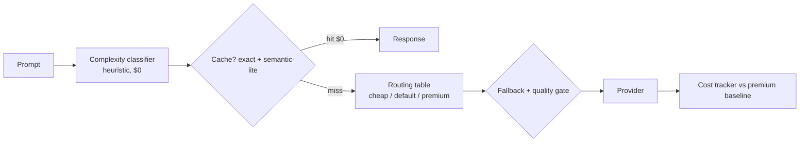

# Cost-Aware Model Router


**Routes by complexity with caching and fallbacks — same answers, half the bill.**

**Target:** -50% spend, under 2% quality drop.
**Shows:** You optimize unit economics, not vibes.

## Problem → Solution
Sending every prompt to your frontier model is paying frontier prices for "what is the capital of France?". This router scores each prompt's complexity with $0-cost heuristics, routes simple → cheap, medium → default, hard → premium, caches exact + near-duplicate prompts, and falls back up the chain on provider errors or a failed quality gate. Every request is tracked against the all-premium counterfactual, so the saving is a number, not a claim.

## Architecture

Full detail: [docs/ARCHITECTURE.md](docs/ARCHITECTURE.md)

## Quickstart (<2 min, offline, mock providers — no API keys)
```bash
git clone https://github.com/lionelsimai/cost-aware-model-router && cd cost-aware-model-router
pip install -e .
model-router route "What is the capital of France?"
model-router benchmark
python benchmarks/benchmark.py
python -m pytest -q
```

## Real demo output
```text
$ model-router route "What is the capital of France?"
tier=cheap model=mock-mini cached=False score=0.05

$ model-router benchmark
requests=66 by_tier={'cheap': 50, 'default': 12, 'premium': 4} cache_hits=50
spend=$0.0032 baseline_premium=$0.0557 saving=94.2%
avg_quality=0.959 (premium=0.97, quality drop=1.1%)
```

## Benchmarks
Simulated traffic (40 simple / 12 medium / 4 complex unique prompts + repeats) in `benchmarks/benchmark.py`:

| Metric | Target | Measured |
|---|---|---|
| Spend saving vs all-premium | ≥ 50% | **94.2%** |
| Quality drop vs premium | < 2% | **1.1%** |
| Cache hits on repeated traffic | — | 50 / 66 requests |

Saving is this large because the mock price spread (mini vs frontier, 60×) mirrors real provider spreads — re-price `models.py` from your provider's current price page before quoting externally; the router mechanics don't change.

## Honest limitations
- Mock providers + mock quality scores: this proves routing/caching/fallback economics, not live answer quality. Wire real providers behind `MockProvider`'s interface and re-measure quality on your golden set.
- The classifier is heuristics, not a learned model — transparent and $0, but it will misroute edge cases; the quality gate + fallback exist for exactly that.
- Semantic-lite is token overlap, not embeddings — cheap and offline, weaker on paraphrase.

## Roadmap
- [ ] Real provider adapters (env-key config, already structured)
- [ ] Embedding-based semantic cache
- [ ] Learned classifier trained on routed-outcome data
- [ ] Per-tenant budgets + spend alerts

## Contributing
See [CONTRIBUTING.md](CONTRIBUTING.md). MIT — [LICENSE](LICENSE). By Lionel Sim, The AI Capitol.
