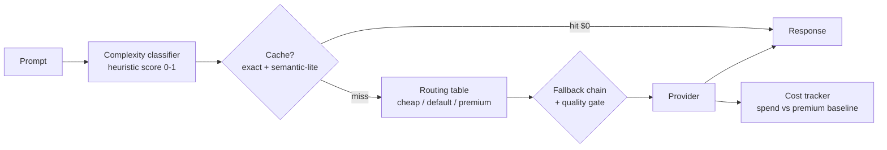

# Architecture

## Modules
- `classifier.py` — transparent heuristics (length, code, reasoning keywords). No model call, so classification itself costs $0.
- `models.py` — routing table with $/1k-token prices; prices are data, update them in one place.
- `cache.py` — SHA-256 exact cache with TTL + semantic-lite (Jaccard token overlap >= threshold).
- `router.py` — cache -> routed tier -> fallback chain, with a per-tier quality gate that steps up.
- `tracker.py` — spend, all-premium counterfactual baseline, saving %, mean quality.
- `providers.py` — deterministic mock providers (offline demo); swap for real SDK calls behind the same interface.

## Honest note on prices
Prices in `models.py` are illustrative mock prices in the shape of real mini/standard/frontier tiers. Re-price from your provider's current price page before quoting savings externally.
