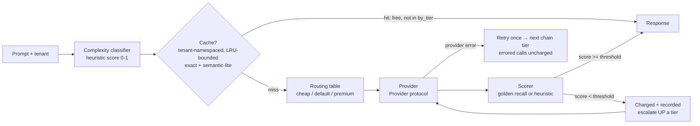

# Architecture

## Components

- `classifier.py` — heuristic complexity score (length, code markers,
  reasoning keywords, multiple questions) → tier thresholds.
- `models.py` — routing table (prices/token estimates) and fallback
  chains. Prices only — no quality constants (deleted in 0.1.1; quality
  is measured, never assumed).
- `providers.py` — `Provider` protocol + `MockProvider`. The mock
  simulates tier behaviour with an answer book and declared
  completeness parameters (simulation inputs, not measurements).
- `scoring.py` — `score_response`: golden mode = content-word recall
  vs the expected answer; heuristic mode = prompt-coverage + length
  adequacy; refusals/empty score 0.
- `router.py` — orchestration: classify → tenant cache → provider with
  retry/chain on errors, quality gate with upward escalation.
- `cache.py` — exact + Jaccard "semantic-lite" matching, TTL, LRU bound
  (`max_entries`), tenant namespacing (a tenant can never read another
  tenant's cached answers, exact or semantic).
- `tracker.py` — spend vs all-premium baseline. `by_tier` counts
  provider calls only; cache hits add baseline but no spend/quality;
  `avg_quality` is the mean of *measured* scores.
- `bench.py` + `benchmark_data.py` — 18 unique golden cases; headline
  run has no repeats; the cache scenario runs separately and is
  labelled as such.

## Fallback semantics

- **Provider error**: retry same tier once, then walk the fallback
  chain (escalate cheap→default→premium; premium may degrade to
  default). Errored calls are not charged. All tiers down →
  `AllProvidersFailedError`.
- **Quality failure**: the call is charged and recorded (the provider
  did the work), the weak response is discarded, and the request
  escalates to a higher tier while one remains. At the top tier the
  best available response is returned.

## Honest limits

- The classifier is a keyword heuristic — the benchmark includes a
  short-but-hard prompt it under-routes, and the measured quality drop
  (1.8%) is exactly that case. A production router would add an
  embedding/LLM judge.
- Mock completeness parameters simulate weaker cheap tiers; with real
  providers the same scorer measures real output.
- The semantic cache is token-set Jaccard, not embeddings.
